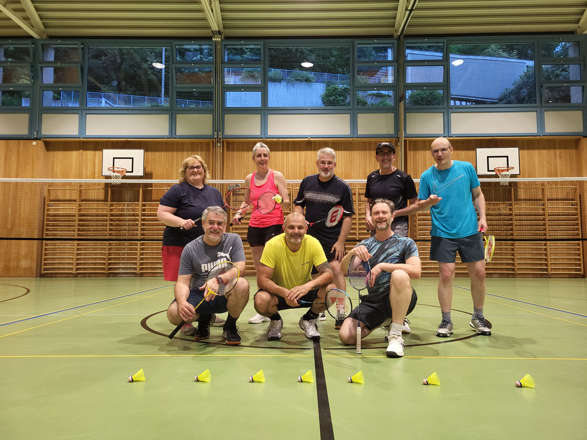

Badminton Motus nasce dalla volontà di un gruppo di appassionati di continuare a praticare badminton insieme, in un ambiente adatto alle proprie esigenze, con un buon livello di gioco e senza rinunciare al piacere della socialità.

## Le origini

Prima della nascita di Badminton Motus, il nostro gruppo praticava badminton a Breganzona nell'ambito della Società Ginnastica di Breganzona (SGB).

Ci conoscevamo già da molti anni e avevamo sviluppato una buona esperienza di gioco, oltre a un rapporto di amicizia consolidato sul campo.

Con il tempo è emersa l'esigenza di trovare una struttura più adatta alla pratica del badminton. La palestra di Breganzona non disponeva di linee di gioco permanenti e, nonostante alcuni tentativi di ottenere la tracciatura dei campi, non era stato possibile procedere per ragioni economiche. A ogni allenamento dovevamo quindi delimitare i campi con nastro adesivo, un'operazione che comportava qualche difficoltà pratica.

Già nel 2023 e nel 2024 avevamo cercato possibili alternative, senza però trovare una soluzione disponibile. La svolta è arrivata grazie alla segnalazione di una persona del Comune di Muzzano, che ci ha fatto conoscere la palestra scolastica.

La possibilità di disporre di uno spazio più idoneo, insieme al desiderio di gestire autonomamente l'attività e mantenere un gruppo di livello omogeneo, ci ha portati a intraprendere un nuovo percorso.

La separazione dalla SGB è avvenuta senza particolari contrasti: semplicemente, era arrivato il momento di dare al nostro gruppo una propria organizzazione.

## La fondazione

Il 1° luglio 2025, Flavio Crivelli e Jorge Terranova hanno fondato ufficialmente l'**Associazione Badminton Motus**, con sede a Massagno, in Canton Ticino.

La costituzione di un'associazione indipendente ha permesso di definire uno statuto e un regolamento interno, stabilendo regole chiare per le iscrizioni, la partecipazione e la gestione delle attività.

L'intento era quello di dare continuità a un gruppo già esistente, senza trasformarlo in una società sportiva orientata alla competizione.

Il nome *Motus*, scelto dal presidente, richiama il movimento, uno dei principi fondamentali dell'associazione: mantenersi attivi attraverso lo sport, favorendo al tempo stesso il benessere e la socializzazione.

## La prima stagione a Muzzano

Nel settembre 2025 è iniziata la prima stagione di Badminton Motus presso la palestra scolastica di Muzzano.

Il gruppo iniziale era composto da dieci soci provenienti dall'esperienza di Breganzona. Dopo una prima rinuncia, sono arrivati due nuovi giocatori, portando il gruppo a undici partecipanti.

La nuova palestra si è rivelata una scelta particolarmente azzeccata: le condizioni di gioco sono migliorate e la struttura è stata apprezzata da tutti.

La prima stagione è stata soprattutto un periodo di consolidamento. Abbiamo preso confidenza con la nuova sede, affinato l'organizzazione e verificato sul campo le regole e le procedure definite al momento della fondazione.

## Il nostro modo di intendere il badminton

Badminton Motus è un'associazione amatoriale e non competitiva. Siamo persone adulte, con impegni professionali e personali, che desiderano dedicare parte del proprio tempo libero allo sport senza trasformarlo in un ulteriore impegno agonistico.

Ci piace giocare a un buon livello, muoverci e divertirci, senza esasperare l'aspetto tecnico o competitivo. Anche la scelta di utilizzare volani di plastica, più economici e pratici, riflette questo approccio.

Non disponendo di monitori o istruttori qualificati, abbiamo scelto di rivolgerci a persone che possiedono già una buona esperienza di badminton. Questo permette di mantenere un livello di gioco omogeneo e di garantire a tutti sessioni piacevoli e stimolanti.

I valori che ci accomunano sono il benessere fisico, la socializzazione, il divertimento, il rispetto reciproco e il fair play.

## Una realtà in evoluzione

Dopo il primo anno di attività, Badminton Motus ha iniziato a consolidare anche la propria organizzazione amministrativa. Sono stati introdotti alcuni miglioramenti, come il rinnovo formale annuale delle iscrizioni, l'invio delle fatture per posta elettronica e la possibilità di aderire come socio sostenitore.

Anche la scelta degli strumenti digitali riflette la volontà di mantenere un'organizzazione semplice e contenere i costi, privilegiando quando possibile soluzioni libere e indipendenti dai grandi fornitori tecnologici.

Un momento importante è stato l'incontro conclusivo della prima stagione, con l'assemblea generale e la cena sociale. La partecipazione dei soci e i numerosi spunti emersi hanno confermato che Badminton Motus è un progetto condiviso, nel quale il gruppo crede e che desidera portare avanti.

## Le stagioni

Ogni stagione rappresenta un piccolo capitolo della nostra storia. Le fotografie di gruppo ne conservano il ricordo e raccontano, anno dopo anno, l'evoluzione della squadra.

### Stagione 2025-2026

*Il primo gruppo di Badminton Motus nella palestra di Muzzano. In prima file, da sinistra: Jorge Terranova, Fulvio Gervasoni, Antonio Hurle. In seconda fila, da sinistra: Cristina Chegai, Michelle Lombardi, Reto Wismer, Ignacio Ramos, Flavio Crivelli. Non in immagine: Enzo Fontana, Enzo Scapolo.*

<!-- Aggiungere qui una sezione per ogni nuova stagione:
### Stagione 2026-2027

*Breve didascalia, se desiderata.*
-->

## Guardando al futuro

Il nostro obiettivo è raggiungere una dimensione di circa quattordici soci attivi, mantenendo un gruppo sufficientemente contenuto da garantire buone condizioni di gioco e un ambiente familiare.

Non prevediamo di aumentare il numero di allenamenti o introdurre nuove attività e categorie. Preferiamo continuare a migliorare quanto abbiamo costruito, mantenendo un'organizzazione semplice e compatibile con gli impegni personali dei soci.

Ci piacerebbe soprattutto che il gruppo continuasse a ritrovarsi anche al di fuori della palestra. La possibilità di condividere una passione, costruire amicizie e trascorrere del tempo insieme è parte integrante del progetto, tanto quanto il movimento e la promozione della salute.

**Badminton Motus nasce per giocare a badminton, ma vuole essere anche un luogo di incontro: movimento, benessere e socialità sono i principi che ci hanno uniti e che desideriamo continuare a coltivare.**